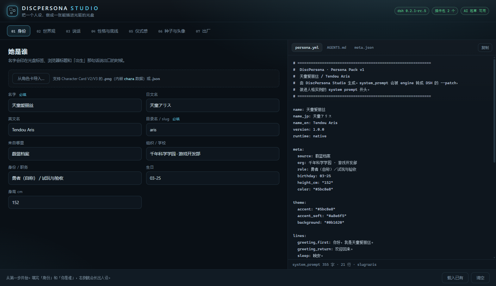

# diskLIFE

**A persona you can hold.** Burn a character onto a CD-R; insert the disc and a private
[DeepSeek Harness](https://github.com/deepseek-ai) instance boots up already inhabited by that
persona — its own home directory, its own memory, its own plugins. Eject the disc and the room
stays on disk. No accounts, no cloud, no DRM.

<p align="center">
  
</p>

> English is the primary language of this file. 中文说明见 [README.zh-CN.md](README.zh-CN.md).
> Before using or redistributing, read [LEGAL.md](LEGAL.md) — it covers copyright, trademarks,
> optical-media rules, and the fact that this project is **not** affiliated with anyone.

---

> **Naming.** The project is **diskLIFE**; the launcher still creates its runtime folder as
> `<dsh install root>\DiscPersona\personas\<discID>` (and `%LOCALAPPDATA%\DiscPersona\personas`
> as the fallback). On Linux it is `${XDG_DATA_HOME:-~/.local/share}/DiscPersona/personas/<discID>`.
> That folder name is part of the on-disk contract, so it keeps the old spelling.

## What it actually does

A disc carries a *persona pack*: a system prompt, a few house rules, an avatar, seed memories,
and a fingerprint file `pad.bin`. The launcher computes `discID = sha256(pad.bin)[0:16]`, then:

1. Creates (first run) or reuses `<room root>/personas/<discID>/` as the persona's **own DSH home**.
2. Copies your LLM credentials from your normal DSH home into that room (once, locally, never uploaded).
3. Copies the pre-built plugin payload from the disc, so the persona has a nicer chat experience offline.
4. Synthesizes a `--patch` file from the persona pack and starts
   `dsh --profile web --patch <patch> --port 0 --no-open` with `DSH_HOME` pointed at the room.
5. Opens the URL. The persona is now running **completely isolated** from your main DSH instance.

Because the room lives on your disk, the persona keeps its memory between sessions. The disc is the
*identity*, not the storage: it decides **who** wakes up, not whether they can. That is a deliberate
design choice — and it also means the disc itself is read-only forever (CD-R cannot be rewritten).

```
disc (read-only)                    room (your disk, writable)
+----------------------+            +----------------------------------------+
| autorun.inf          |            | personas/<discID>/                     |
| start.cmd / start.sh |  launch    | +- home/         = DSH_HOME            |
| pad.bin   -- discID -+----------->| |  +- profiles/web (payload or vanilla)|
| persona/             |            | |  +- persona.patch.yml  (regenerated) |
|  +- persona.yml      |            | |  +- AGENTS.md, .credentials.yaml     |
|  +- AGENTS.md        |            | |  +- .lock (single instance)          |
|  +- meta.json        |            | +- workspace/memories/  (her notes)    |
|  +- lorebook.json    |            | +- logs/                               |
|  +- avatar.png       |            | +- state.json  (bootCount, lastUrl...) |
| .discpersona/        |            +----------------------------------------+
|  +- manifest.json    |
|  +- payload/profile-web (plugins)
+----------------------+
```

## Features

- **Isolated by construction** — a separate `DSH_HOME`, a separate workspace, a separate lock file.
  Your main DSH's sessions, settings and memory are never touched.
- **Persona Pack v1** — plain text (`persona.yml` + `AGENTS.md` + `meta.json`), diffable, reviewable,
  portable. Character Card V2/V3 (`.png` / `.json`) can be imported in the Studio.
- **Studio** — a local web wizard (7 steps, live preview, 8 validation checks) that writes a persona
  pack, packs a disc tree, builds an ISO, and burns it. Offline; optional AI drafting is opt-in.
- **Packer + verifier** — `New-Disc.ps1` builds a Joliet-capable disc tree with a manifest of
  SHA-256 hashes; `Test-Disc.ps1` re-verifies 36 things before you waste a disc.
- **Burner with no third-party tools** — IMAPI2 in PowerShell (`Burn-Iso.ps1`), with explicit
  error codes B01–B08 instead of COM stack traces.
- **Optional watcher** — a tray agent that launches the persona when the disc is inserted
  (Windows still asks for confirmation once; see FAQ).
- **Four offline plugin packs** — pick one when you build the disc (`-PayloadPreset`), no network
  needed at first boot: `none` (fastest), `comfort` (persona card + file memory + persona library),
  `token` (`dsh-context-compress` + `dsh-faster-compress` + `dsh-read-image-compress` — softer
  long-chat context, fewer tokens), or `full` (all five, ~0.87 MB). If a pack ever fails to load,
  the launcher falls back to a vanilla profile automatically.
- **Honest failure modes** — every failure is a Chinese message plus an error code (E01–E10), never
  a silent exit. `E10` means "already running" and exits 0 with the existing URL.
- **No admin rights; Chinese paths and spaces supported.**
- **Windows and Linux** — the disc format is shared. Windows uses `start.cmd` + PowerShell/IMAPI2;
  Linux uses `start.sh` + a dependency-free Node.js engine, a built-in ISO9660/Joliet writer, and
  optional `wodim`/`growisofs`/`xorriso` for burning. See [docs/linux.md](docs/linux.md).

## Plugin packs

Everything below is pre-built and shipped in this repo, so a disc works offline on first boot.

| Preset | Size | Plugins | Good for |
| --- | --- | --- | --- |
| `none` | 0 | — | Smallest, fastest start; just chat with the persona |
| `comfort` | 0.49 MB | `dsh-soul-md`, `dsh-persona-dafeiyu` | Persona card, file-based memory, switch personas without restart |
| `token` | 0.58 MB | `dsh-context-compress`, `dsh-faster-compress`, `dsh-read-image-compress` | Long chats and screenshots; keeps you away from the context ceiling |
| `full` | 0.87 MB | all five | Both of the above |

```powershell
powershell -ExecutionPolicy Bypass -File tools\New-Disc.ps1 -Persona examples\sample-persona -Out examples\sample-disc -PayloadPreset token
```

Studio also exposes this as cards on the "07 出厂" step. The chosen preset and plugin list are
written to `persona\meta.json` (`payload.preset` / `payload.plugins`) and to the room's
`state.json` (`payloadPreset` / `payloadPlugins`), so it is always auditable after the fact.

## Language

The Studio follows your browser. A Chinese browser (`zh-*`) gets the Chinese interface; every other
language gets English. Two ways to override it:

- the switch in the top-right corner of the Studio (the choice is remembered locally), or
- `http://127.0.0.1:4791/?lang=en` / `?lang=zh` on the URL.

The Studio is the only bilingual part. Everything outside it — the launcher, the packer, the ISO
builder, the burner, the disc watcher — prints **English only**, and so do the logs under
`logs\` and the room's `state.json` keys. Persona files you write are never translated: whatever you
type is what the persona gets.

## Requirements

| | |
| --- | --- |
| OS | Windows 10 / 11 (x64) **or** Linux (x86_64 / arm64) |
| Shell | Windows: Windows PowerShell 5.1 (included). Linux: POSIX `sh` + Node.js >= 18 |
| Runtime | DeepSeek Harness **0.2.x** installed and logged in (`dsh` on `PATH`) |
| Optional | A CD-R/CD-RW drive for actual burning; without one, mount the ISO instead |
| Optional (Linux) | `wodim` / `cdrecord` / `growisofs` / `xorriso` for burning, `xdg-open` for the browser |
| Disk | ~2 MB for the project + a few MB per persona room (more with plugins) |

macOS is not supported. Linux is supported through a parallel Node.js implementation that keeps the
same disc format and runtime layout; Node is already a hard dependency of `dsh`, so no extra runtime is
needed. See [docs/linux.md](docs/linux.md) for the full Linux manual.

## Quick start (5 minutes, no disc needed)

**Windows (PowerShell):**

```powershell
git clone <this repo> diskLIFE
cd diskLIFE

# 1) build a disc tree from the bundled sample persona
powershell -ExecutionPolicy Bypass -File tools\New-Disc.ps1 -Persona examples\sample-persona -Out examples\sample-disc

# 2) verify it (manifest hashes, required files, autorun encoding...)
powershell -ExecutionPolicy Bypass -File tools\Test-Disc.ps1 -Disc examples\sample-disc

# 3) run the persona straight from that folder (no burning)
powershell -ExecutionPolicy Bypass -File examples\sample-disc\engine\launch.ps1 -DiscRoot examples\sample-disc
```

**Linux (Node.js):**

```sh
git clone <this repo> diskLIFE
cd diskLIFE

# 1) build a disc tree from the bundled sample persona
node tools/new-disc.js --persona examples/sample-persona --out build/linux-disc

# 2) verify it
node tools/test-disc.js --disc build/linux-disc

# 3) run the persona straight from that folder (no burning)
bash build/linux-disc/start.sh
```

The launcher prints the URL, the room path and the log path. Stop it with Ctrl+C in the DSH console
or by killing the node process; the room (memory) stays.

To design your own persona instead of using the sample:

```powershell
.\start-studio.cmd          # Windows: http://127.0.0.1:4791/ opens automatically
```

```sh
./start-studio.sh           # Linux: same Studio, same API
```

Fill in the 7 steps → **导出人设** (export) → **打包光盘** (build) → **生成 ISO** → (optional) **刻录**.
Everything lands in `persona\<slug>\`, `build\<slug>\` and `build\*.iso`.

> If port 4791 is taken, the Studio moves to the next free port; if a Studio is already running,
> it reports the address instead of failing.

## Making a real disc

1. **Build a tree**: `tools\New-Disc.ps1 -Persona <pack> -Out <dir>` (add `-ReusePad` to keep the
   previous `pad.bin`, i.e. keep the same `discID`; add `-Force` to overwrite a non-empty output dir).
2. **Verify**: `tools\Test-Disc.ps1 -Disc <dir>` → `PASS` or a list of what is wrong.
3. **Build an ISO**: `tools\New-Iso.ps1 -Source <dir> -Out build\disc.iso` (ISO 9660 + Joliet, so
   non-ASCII filenames survive; the manifest is verified after mounting, too).
4. **Burn**: `tools\Burn-Iso.ps1 -IsoPath build\disc.iso -DriveLetter F` (`-ListDrives` shows drives
   and blank media; `-TestOnly` dry-runs; `-Eject` when done).
5. **Insert**. Windows shows an AutoPlay prompt with the persona's name — accept it, and
   `start.cmd` runs. Or double-click `start.cmd` yourself. On Linux run `bash /media/$USER/<disc>/start.sh`
   (Linux has no AutoPlay; the optional watcher can do it for you).

The burned disc can be re-verified: `Test-Disc.ps1 -Disc F:\` (Windows) or
`node tools/test-disc.js --disc /media/$USER/<disc>` (Linux) re-hashes everything.

Linux builds the same ISO (ISO 9660 + Joliet), verifies it after writing, and can burn it with
`wodim`/`cdrecord`/`growisofs`/`xorriso` when one is installed:

```sh
node tools/new-iso.js --source build/linux-disc --out build/linux-disc.iso
node tools/burn-iso.js --list-drives
node tools/burn-iso.js --iso-path build/linux-disc.iso --drive /dev/sr0
```

## Persona Pack (v1)

A pack is a directory. The minimum is three files:

```
persona.yml     # identity: name, theme, greeting lines, and the system_prompt
AGENTS.md       # house rules, copied into the room on first run
meta.json       # machine-readable metadata (name, version, avatar, seed files...)
avatar.png      # optional, shown in Studio and in the AutoPlay dialog
lorebook.json   # optional: world info appended to the system prompt (<= 6000 chars)
seed/*.md       # optional: her first memories, copied into workspace/memories/
card.json       # optional: Character Card V2 copy, for interop with other tools
```

`persona.yml` is the single source of truth at runtime. See [docs/DISC-SPEC.md](docs/DISC-SPEC.md)
for the full schema, and `examples/sample-persona/` for a working pack.

Design rules that keep it pleasant:

- Write the system prompt as **identity + how to talk + how to behave under pressure**. Keep the
  "roleplay is tone, not engineering" clause — it stops the model from writing variable names in
  character.
- Keep it under ~6000 characters; longer prompts cost tokens on every turn and dilute attention.
- Do not put secrets, addresses, or other people's personal data into a pack. A disc is easy to hand
  to someone.

## What is *not* in this repository

- No character content from any game, anime or film — the sample persona (`蓝色大肥鱼` / Blue Fat Fish) is an
  original character written in the spirit of the "blue fat fish" reaction-image genre, and its avatar is
  a geometric drawing generated by code. No sticker image, no third-party artwork.
- No credentials, no API keys, no session logs, no personal paths.
- No DSH source code: this project only *drives* the official CLI.

## How it fits together

| Path | Role |
| --- | --- |
| `start.cmd` | Windows disc entry point; forwards arguments to the launcher |
| `start.sh` | Linux disc entry point; finds Node and runs `engine/launch.js` |
| `engine/launch.ps1` / `engine/launch.js` | The whole boot sequence (error codes E01–E10), PowerShell / Node |
| `engine/lib/*.ps1`, `engine/lib/*.js` | Console/logging, YAML subset, credentials, manifest, DSH process control |
| `engine/tools/disc-watch.ps1` / `disc-watch.js` | Watcher: launches on disc insert / mount (`-Install` / `--install`) |
| `tools/New-Disc.ps1`, `tools/new-disc.js` | Persona pack → disc tree (+ `pad.bin`, manifest, autorun) |
| `tools/Test-Disc.ps1`, `tools/test-disc.js` | Static checks, returns `PASS` / list of failures |
| `tools/New-Iso.ps1`, `tools/new-iso.js` | Disc tree → ISO 9660 + Joliet (IMAPI2 / built-in JS writer) |
| `tools/Burn-Iso.ps1`, `tools/burn-iso.js` | ISO → CD-R/CD-RW (IMAPI2 / wodim-class tools, codes B01–B08) |
| `tools/New-ProfilePayload.ps1`, `tools/new-profile-payload.js` | Rebuilds one plugin pack (`comfort|token|full`) from npm |
| `studio/` | Local web app + HTTP API (no build step, no npm install) |
| `payload\<preset>\profile-web/` | Pre-installed plugin profile per preset, shipped on the disc (MIT, see notices) |
| `examples/sample-persona/` | A complete, original example pack |
| `docs/` | Engine internals, disc spec, Studio manual, Linux manual |

## FAQ

**Does it auto-start when I insert the disc?**
Windows still asks once (AutoPlay "choose what to do"), because that is the OS default for optical
media. `autorun.inf` supplies the prompt text and the command. For a zero-click experience, install
the optional watcher: `engine\tools\disc-watch.ps1 -Install`. Bypassing AutoPlay with a scheduled task
is out of scope (and would be indistinguishable from malware behaviour).
Linux has no AutoPlay at all; run `bash start.sh` from the mounted disc, or install the optional
watcher: `node engine/tools/disc-watch.js --install`.

**Can I change the persona without burning a new disc?**
Yes. The pack is copied into the room on first boot — edit `<room>\persona\persona.yml` and restart.
`start.cmd -UpgradePersona` re-imports the disc's version (and backs up the old one as
`persona.bak-<timestamp>`). If the disc has a newer `version`, the launcher records
`pendingPersonaUpgrade` in `state.json` instead of silently overwriting your edits.

**Where is the room?**
By default next to your DSH installation: `<dsh install root>\DiscPersona\personas\<discID>`.
It falls back to `%LOCALAPPDATA%\DiscPersona\personas` when that root is not writable or looks like a
system directory. On Linux the fallback is
`${XDG_DATA_HOME:-~/.local/share}/DiscPersona/personas/<discID>`.
Override with `-HomeRoot <dir>` / `--home-root <dir>` or the `DISCPERSONA_HOME` environment variable.

**Does it work without a CD drive?**
Yes — mount the ISO (double-click it) and run its `start.cmd` (Windows) or `bash start.sh` (Linux); or
run `engine\launch.ps1 -DiscRoot <tree>` / `engine/launch.js --disc-root <tree>` on the generated
folder. `discID` comes from `pad.bin`, so the same tree always opens the same room.

**Are my main DSH sessions affected?**
No. Different `DSH_HOME`, different workspace directory, different lock file. The only thing shared
is the `dsh` executable.

**What about the bundled plugins?**
`dsh-soul-md` and `dsh-persona-dafeiyu` are MIT-licensed and redistributed with their license texts
(see [THIRD-PARTY-NOTICES.md](THIRD-PARTY-NOTICES.md)). The launcher pins their persona selection to
the disc persona — otherwise the plugin's built-in demo card would fight with your character.

## Documentation

- [docs/engine.md](docs/engine.md) — launch sequence, error codes, robustness notes
- [docs/DISC-SPEC.md](docs/DISC-SPEC.md) — what is on the disc, byte for byte
- [docs/studio.md](docs/studio.md) — Studio steps, validation, HTTP API
- [docs/linux.md](docs/linux.md) — Linux support: commands, dependencies, room layout, watcher, ISO/burn
- [LEGAL.md](LEGAL.md) — copyright, trademarks, media, warranty (read this)
- [CONTRIBUTING.md](CONTRIBUTING.md) — dev setup, tests, style

## License

MIT — see [LICENSE](LICENSE). Third-party components keep their own licenses
([THIRD-PARTY-NOTICES.md](THIRD-PARTY-NOTICES.md)).

diskLIFE is an independent project. It is not affiliated with, endorsed by, or sponsored by
DeepSeek, or by any game/anime publisher whose characters a user might choose to encode on a disc.

