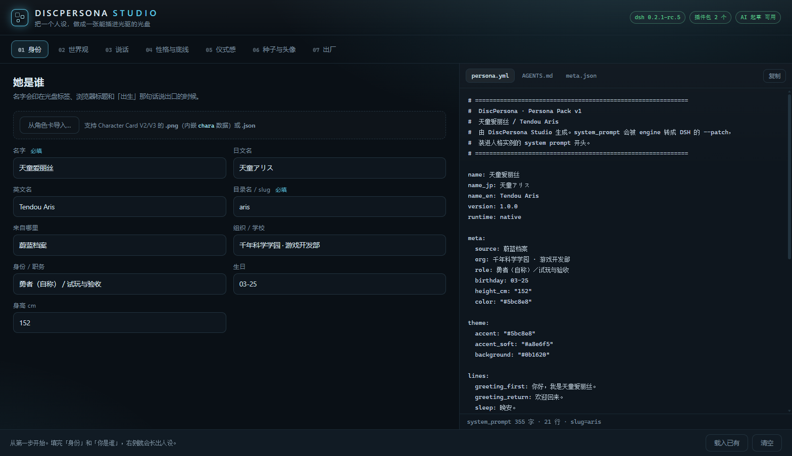

# diskLIFE · 人设的物理载体与开关

**一个你能拿在手里的人设。** 把角色刻进 CD-R，插盘即起一个**独立**的
DeepSeek Harness 实例——它有自己的 home、自己的记忆、自己的插件；拔盘之后，那间房还在硬盘上。
不联网、不要账号、不做 DRM。

<p align="center">
  
</p>

> 本文件是中文说明；English first → [README.md](README.md)。
> 使用或再分发前请先读 [LEGAL.md](LEGAL.md)：里面写了版权、商标、光盘介质、免责声明，
> 以及「本项目与任何厂商/作品无关」。

---

> **关于名字。** 项目名是 **diskLIFE**；启动器创建的房间目录仍叫
> `<dsh 安装根>\DiscPersona\personas\<discID>`（兜底 `%LOCALAPPDATA%\DiscPersona\personas`）。
> 那个目录名属于磁盘契约，所以保留旧拼写。

## 它到底做了什么

光盘里装着一份**人设包**（persona pack）：一段 system prompt、几条家规、一张头像、几页初始记忆，
以及一个指纹文件 `pad.bin`。启动器算出 `discID = sha256(pad.bin)[0:16]`，然后：

1. 在 `<房间根>/personas/<discID>/` 建（首次）或复用**独立的 DSH home**；
2. 把你平时那份 DSH 的 LLM 凭据**复制**进这间房（只在本机，一次，不上传）；
3. 把盘上预打包的插件载荷复制进 profile（离线也有完整的对话体验）；
4. 根据人设包合成 `--patch`，以 `DSH_HOME=<房间>/home` 启动
   `dsh --profile web --patch <patch> --port 0 --no-open`；
5. 打开地址。这个人和你的主 DSH **完全隔离**。

因为房间在硬盘上，人格的记忆会跨次延续。**光盘是身份，不是存储**：它决定「谁醒来」，
不决定「能不能醒来」——这是刻意的取舍（也因此盘本身永远是只读的，CD-R 写一次就定）。

```
光盘（只读）                          房间（你的硬盘，可写）
+----------------------+            +----------------------------------------+
| autorun.inf          |            | personas/<discID>/                     |
| start.cmd            |  启动      | +- home/         = DSH_HOME            |
| pad.bin   -- discID -+----------->| |  +- profiles/web（载荷或原生）       |
| persona/             |            | |  +- persona.patch.yml（每次启动重写）|
|  +- persona.yml      |            | |  +- AGENTS.md、.credentials.yaml     |
|  +- AGENTS.md        |            | |  +- .lock（单实例锁）                |
|  +- meta.json        |            | +- workspace/memories/（她的记忆）     |
|  +- lorebook.json    |            | +- logs/                               |
|  +- avatar.png       |            | +- state.json（bootCount、lastUrl…）   |
| .discpersona/        |            +----------------------------------------+
|  +- manifest.json    |
|  +- payload/profile-web（插件）
+----------------------+
```

## 特性

- **天然隔离**：独立 `DSH_HOME`、独立工作区、独立锁文件；主 DSH 的会话/设置/记忆一概不碰。
- **Persona Pack v1**：纯文本（`persona.yml` + `AGENTS.md` + `meta.json`），可 diff、可 review、可移植。
  Studio 支持导入 Character Card V2/V3（`.png` / `.json`）。
- **Studio 上位机**：本地网页七步向导，实时预览、8 项校验，一键导出人设包 / 打包光盘 / 生成 ISO / 刻录。
  全程离线；AI 起草是可选项，默认关闭。
- **打包器 + 校验器**：`New-Disc.ps1` 生成带 SHA-256 清单的光盘目录树；`Test-Disc.ps1` 先做 36 项检查，
  别在坏盘上浪费 CD-R。
- **不依赖第三方刻录软件**：纯 PowerShell + IMAPI2（`Burn-Iso.ps1`），失败给 B01–B08 明确错误码，
  而不是 COM 堆栈。
- **可选守望者**：托盘常驻脚本，插盘即拉起（Windows 仍会问一次确认，见 FAQ）。
- **四组离线插件包**：打包时选一组（`-PayloadPreset`），首启不需要联网——`none`（最快）、
  `comfort`（人设卡 + 文件式记忆 + 人设库）、`token`（`dsh-context-compress` + `dsh-faster-compress` +
  `dsh-read-image-compress`，长对话更省 token）、`full`（五个都要，约 0.87 MB）；
  万一加载失败，启动器会自动回退到原生 profile。
- **失败说得清**：每个错误都是中文说明 + 错误码（E01–E10），不静默退出；`E10` 表示「已经在跑」，
  退出码 0 并给出已有的 URL。
- **不需要管理员权限，中文路径与空格路径可用。**

## 界面语言

Studio 跟随浏览器：中文环境（`zh-*`）显示中文，其它语言环境显示英文。两种覆盖方式：

- 点 Studio 右上角的语言按钮（选择会记在本地），或
- 在地址后面加 `?lang=en` / `?lang=zh`，例如 `http://127.0.0.1:4791/?lang=en`。

只有 Studio 是双语的。Studio 以外的一切——启动器、打包器、ISO 生成、刻录、光驱守望者——**只输出英文**，
`logs\` 下的日志与房间的 `state.json` 字段同理。人设文件不会被翻译：你写什么，她就拿到什么。

## 环境要求

| | |
| --- | --- |
| 系统 | Windows 10 / 11（x64） |
| Shell | Windows PowerShell 5.1（系统自带） |
| 运行时 | DeepSeek Harness **0.2.x**，已安装并登录（`dsh` 在 `PATH` 上） |
| 可选 | 一台 CD-R/CD-RW 光驱；没有也能用（挂载 ISO） |
| 空间 | 项目约 2 MB；每间房几 MB（装插件更多） |

macOS/Linux **不支持**：启动器、刻录、守望者都是 Windows 专属（IMAPI2 + WMI）。
只移植启动器是可行的，欢迎 PR，但不要弄坏 Windows 路径。

## 五分钟上手（不需要光盘）

```powershell
git clone <本仓库> diskLIFE
cd diskLIFE

# 1) 用自带示例人设打一张盘（输出到 examples/sample-disc）
powershell -ExecutionPolicy Bypass -File tools\New-Disc.ps1 -Persona examples\sample-persona -Out examples\sample-disc

# 2) 先校验（36 项：清单哈希、必需文件、autorun 编码……）
powershell -ExecutionPolicy Bypass -File tools\Test-Disc.ps1 -Disc examples\sample-disc

# 3) 直接从目录启动，不用刻盘
powershell -ExecutionPolicy Bypass -File examples\sample-disc\engine\launch.ps1 -DiscRoot examples\sample-disc
```

启动器会打印地址、房间路径、日志路径。要停就在 DSH 控制台按 Ctrl+C，或结束那个 node 进程；
房间（记忆）留着。

想做自己的人设：

```powershell
.\start-studio.cmd          # 自动打开 http://127.0.0.1:4791/
```

七个步骤填完 → **导出人设** → **打包光盘** → **生成 ISO** →（可选）**刻录**。
产物分别落在 `persona\<slug>\`、`build\<slug>\`、`build\*.iso`。

> 4791 被占用会自动顺延；已经有 Studio 在跑时，不报错，直接告诉你地址。

## 刻一张真盘

1. **打目录**：`tools\New-Disc.ps1 -Persona <人设包> -Out <目录>`
   （`-ReusePad` 复用上次的 `pad.bin`，即保持同一个 discID；`-Force` 才允许覆盖非空目录）。
2. **校验**：`tools\Test-Disc.ps1 -Disc <目录>` → `PASS` 或列出问题。
3. **做 ISO**：`tools\New-Iso.ps1 -Source <目录> -Out build\disc.iso`
   （ISO 9660 + Joliet，中文文件名不会丢；挂载后还会复核清单）。
4. **刻录**：`tools\Burn-Iso.ps1 -IsoPath build\disc.iso -DriveLetter F`
   （`-ListDrives` 看光驱与空白介质；`-TestOnly` 只演练；`-Eject` 刻完弹出）。
5. **插盘**：Windows 会带人设名弹一次 AutoPlay 提示，确认即运行 `start.cmd`；也可以自己双击。

刻完可以回读复核：`Test-Disc.ps1 -Disc F:\` 会重新算一遍哈希。

## 人设包（v1）

一个目录，最少三个文件：

```
persona.yml     # 身份：名字、主题色、开场白，以及 system_prompt
AGENTS.md       # 家规，首启复制进房间
meta.json       # 机器可读元信息（名字、版本、头像、seed 文件……）
avatar.png      # 可选，Studio 与 AutoPlay 对话框里显示
lorebook.json   # 可选：世界设定，拼在 system prompt 末尾（≤ 6000 字）
seed/*.md       # 可选：她最初的记忆，复制进 workspace/memories/
card.json       # 可选：Character Card V2 副本，便于与其他工具互通
```

运行时 `persona.yml` 是唯一真源。完整字段见 [docs/DISC-SPEC.md](docs/DISC-SPEC.md)，
可直接参考 `examples/sample-persona/`。

几条写人设的经验：

- system prompt 写三段就够：**你是谁 / 你怎么说话 / 压力下怎么办**。
  务必保留「人设只影响语气，不影响技术准确性」那条——否则模型会用角色口吻写变量名。
- 控制在 6000 字以内；再长每轮都在烧 token、还稀释注意力。
- 别把人设包当保险箱：不要写密码、地址、别人的隐私。盘是很容易递给别人的东西。

## 本仓库**没有**什么

- 没有任何游戏 / 动画 / 影视的角色内容——示例人设「蓝色大肥鱼」是「表情包风格、但不是表情包复制」的原创角色：
  文字自写、头像由代码逐像素绘制，没有使用任何表情包图片或第三方美术。
- 没有凭据、API key、会话日志、个人路径。
- 没有 DSH 源码：本项目只**驱动**官方 CLI。

## 目录结构

| 路径 | 作用 |
| --- | --- |
| `start.cmd` | 光盘入口，参数透传给启动器 |
| `engine/launch.ps1` | 整个启动流程（错误码 E01–E10） |
| `engine/lib/*.ps1` | 控制台/文案、YAML 子集、凭据、清单校验、dsh 进程控制 |
| `engine/tools/disc-watch.ps1` | 插盘守望者（`-Install` / `-Uninstall`） |
| `tools/New-Disc.ps1` | 人设包 → 光盘目录（写 `pad.bin`、manifest、autorun） |
| `tools/Test-Disc.ps1` | 36 项静态检查，输出 `PASS` / 失败列表 |
| `tools/New-Iso.ps1` | 光盘目录 → ISO（IMAPI2，ISO 9660 + Joliet） |
| `tools/Burn-Iso.ps1` | ISO → CD-R/CD-RW（IMAPI2，错误码 B01–B08） |
| `tools/New-ProfilePayload.ps1` | 从 npm 重建某一组插件包（`-Preset comfort|token|full`） |
| `studio/` | 本地网页 + HTTP API（不需要 npm install、不需要构建） |
| `payload\<preset>\profile-web/` | 按预设分库的随盘插件 profile（MIT，见第三方声明） |
| `examples/sample-persona/` | 完整可用的原创示例人设 |
| `docs/` | 引擎内幕、光盘规范、Studio 手册 |

## FAQ

**插盘会自动启动吗？**
Windows 仍会问一次（AutoPlay「选择要执行的操作」），这是光驱介质的系统默认行为。
`autorun.inf` 负责提供提示文案和命令。想要零点击就装守望者：
`engine\tools\disc-watch.ps1 -Install`。用计划任务绕过 AutoPlay 不在范围内（那和恶意软件的行为没区别）。

**不重刻盘能换人设吗？**
能。首启时人设包已固化进房间——改 `<房间>\persona\persona.yml` 后重启即可。
`start.cmd -UpgradePersona` 会用盘上的版本覆盖（旧版备份成 `persona.bak-<时间戳>`）。
如果盘上的 `version` 更新，启动器只在 `state.json` 里记 `pendingPersonaUpgrade`，不会偷偷覆盖你的修改。

**房间在哪？**
默认跟着 dsh 安装位置：`<dsh 安装根>\DiscPersona\personas\<discID>`。推断不到（或那目录像系统目录/
不可写）时退回 `%LOCALAPPDATA%\DiscPersona\personas`。可用 `-HomeRoot <目录>` 或环境变量
`DISCPERSONA_HOME` 指定。

**没有光驱能用吗？**
能。双击 ISO 挂载后运行里面的 `start.cmd`；或对生成的目录直接跑
`engine\launch.ps1 -DiscRoot <目录>`。`discID` 由 `pad.bin` 决定，同一棵树永远打开同一间房。

**会影响我主 DSH 的会话吗？**
不会。`DSH_HOME`、工作区、锁文件都不同，唯一共用的是 `dsh` 可执行文件。

**盘里的插件呢？**
`dsh-soul-md` 与 `dsh-persona-dafeiyu` 都是 MIT，随附许可证文本
（见 [THIRD-PARTY-NOTICES.md](THIRD-PARTY-NOTICES.md)）。启动器会把插件的人设选择钉到盘上人设，
否则插件内置的示例卡会和你的角色打架。

## 文档

- [docs/engine.md](docs/engine.md) — 启动流程、错误码、健壮性修复记录
- [docs/DISC-SPEC.md](docs/DISC-SPEC.md) — 盘上到底有什么（逐文件）
- [docs/studio.md](docs/studio.md) — Studio 七步、校验规则、HTTP 接口
- [LEGAL.md](LEGAL.md) — 版权、商标、介质、免责（请读）
- [CONTRIBUTING.md](CONTRIBUTING.md) — 开发、测试、代码风格

## 许可证

MIT，见 [LICENSE](LICENSE)。第三方组件保留各自许可证（[THIRD-PARTY-NOTICES.md](THIRD-PARTY-NOTICES.md)）。

diskLIFE 是独立项目，与 DeepSeek、与任何游戏/动画发行方均无关联、未获其背书或赞助。

## 插件包

下面四组都随仓库预置好了，打包即用，首次启动不需要联网。

| 预设 | 体积 | 插件 | 适合 |
| --- | --- | --- | --- |
| `none` | 0 | —— | 最轻最快，只要「插盘就能聊天」 |
| `comfort` | 0.49 MB | `dsh-soul-md`、`dsh-persona-dafeiyu` | 人设卡、文件式记忆、免重启换人设 |
| `token` | 0.58 MB | `dsh-context-compress`、`dsh-faster-compress`、`dsh-read-image-compress` | 聊得久、贴图多，不想很快顶到上下文上限 |
| `full` | 0.87 MB | 以上五个 | 两样都要 |

```powershell
powershell -ExecutionPolicy Bypass -File tools\New-Disc.ps1 -Persona examples\sample-persona -Out examples\sample-disc -PayloadPreset token
```

Studio 的「07 出厂」页也有对应的四张卡片。用的是哪一组，会写进 `persona\meta.json` 的
`payload.preset` / `payload.plugins`，以及房间 `state.json` 的 `payloadPreset` / `payloadPlugins`。

## 运行要求

| | |
| --- | --- |
| 系统 | Windows 10 / 11（x64） |
| Shell | Windows PowerShell 5.1（系统自带） |
| 运行时 | 已安装并登录过的 DeepSeek Harness **0.2.x**（`dsh` 在 `PATH` 里） |
| 可选 | 真刻盘需要一台 CD-R/CD-RW 光驱；没有光驱就挂载 ISO |
| 磁盘 | 项目本身约 2 MB，每个人格房间几 MB（装了插件会多几 MB） |

macOS / Linux **不支持**：启动器、刻录、守望者都是 Windows 专属（IMAPI2 + WMI）。
只移植启动器是可行的；欢迎不破坏 Windows 的 PR。
