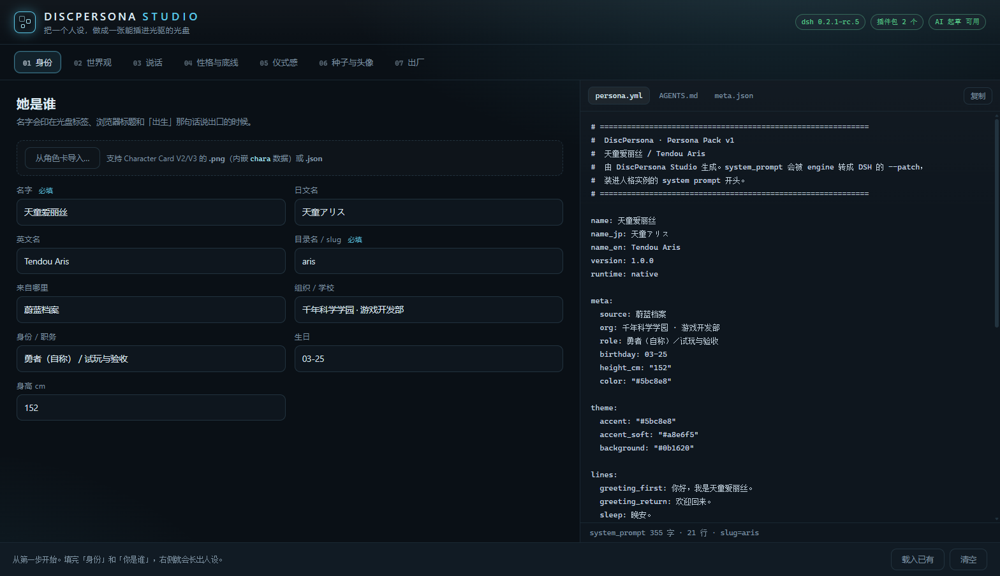

# DiscPersona Studio · 造一个人，做成一张盘

> 一个跑在 `127.0.0.1` 上的本地网页工作台：七步表单 → 实时预览 → 导出人设包 → 打包光盘目录 → 生成 ISO → 刻录。
> 零外部依赖：只需要 Windows 自带的 PowerShell 5.1。它不联网，AI 起草默认关闭。



## 启动

双击仓库根目录的 `start-studio.cmd`，或：

```powershell
powershell -ExecutionPolicy Bypass -File studio\server.ps1 -Port 4791
```

浏览器会打开 `http://127.0.0.1:4791/`。服务只绑回环地址，局域网里的别人连不上。

端口相关有两种情况会自动处理，不用手动改参数：

- **已经有一个 Studio 在跑**（比如重复双击了 `start-studio.cmd`）：不会再起第二个，直接把浏览器指向那个实例，并打印它的地址；如果它服务的是别的工作区，会额外提醒一句。
- **4791 被别的程序占了**：自动往后找空端口（4791–4811），打印实际使用的地址。`HttpListener` 在前缀残留注册的情况下会绑定失败，这时同样会自动顺延。

- `-Port 0` 让系统选端口（端口会打印在控制台）。
- `-NoBrowser` 不自动开浏览器。

## 从 Character Card 导入

第一步最上面有「导入角色卡」按钮，支持 **PNG（带 `chara` 数据块）** 和 **JSON（V2/V3 导出文件）**。
SillyTavern / Risu / 酒馆系工具导出的角色卡可以直接拖进来，不用手抄字段。

| 卡里的字段 | 落到哪 |
| --- | --- |
| `name` / `character_version` | 名字 / 版本 |
| `description` | 「你是谁」（身份自述） |
| `personality` | 性格（按行拆成一条条） |
| `scenario` | 「你跟对方的关系」 |
| `first_mes` | 首句台词 |
| `mes_example` | 追加到说话风格，并注明「示例对话，照这个语气说话」 |
| `post_history_instructions` | 追加到底线 |
| `system_prompt` | 存进 `state.cardSystemPrompt`，导出时写回 `card.json`（不覆盖 DSH 的 patch 正文） |
| `alternate_greetings` | 备选开场白（最多 20 条） |
| `character_book` | `lorebook.json`（世界书） |
| 卡图本身 | `avatar.png`（512×512 建议，用作光盘图标与浏览器图标） |

导入后按钮下方会列出「已导入：阿露 · 11 项」以及每一项来自哪个字段，方便核对。

**几个边界**

- **V1 卡请先导出成 V2**：V1 字段是平铺的，且没有世界书/备选开场，导进来会缺东西。
- **压缩的 iTXt 块不支持**：`chara` 块用 zlib 压缩过的（`flag=1`）会提示暂不支持，先在酒馆里另存。
- **纯中文名**：slug 会用名字的稳定散列生成（如 `persona-1dqylf`），同一个名字每次得到同一个目录；想改就在「目录名 / slug」里手填。
- **世界书全部常驻**：DiscPersona 走 `--patch` 通道，没有关键词检索，所以引擎会把 `lorebook.json` 的全部条目拼进人设末尾（`constant` 优先，上限 6000 字，超出的写进日志）。卡里那些「只在提到某词时触发」的条目，在这张盘上会一直生效——这是刻意的取舍，不是 bug。

## 七步都填什么

| 步骤 | 填的东西 | 落到哪里 |
| --- | --- | --- |
| 01 身份 | 名字 / 日文名 / 英文名 / 目录名 slug / 出处 / 组织 / 职务 / 生日 / 身高 | `persona.yml` 的 `name*`、`meta.json` |
| 02 世界观 | 她所在的世界、她与「你」的关系 | `system_prompt` 前两段、`lorebook.json` |
| 03 说话 | 自称、称呼你、口癖、句长、禁语 | `system_prompt` 的「你怎么说话」 |
| 04 性格与底线 | 三个性格关键词、会/不会做的事、硬底线 | `system_prompt` + `AGENTS.md` 的家规 |
| 05 仪式感 | 主题色、首启/再启/休眠文案、思考中提示 | `meta.json` 的 `theme` / `boot` |
| 06 种子与头像 | 初始记忆（两页 markdown）、头像 | `seed/*.md`、`avatar.png` |
| 07 出厂 | **选插件包** + 校验 + 导出 + 打包 + ISO + 刻录 | 磁盘 |

「07 出厂」最上面是**插件包**选择（四选一，卡片上标了体积和具体插件）：

| 预设 | 说明 |
| --- | --- |
| `none` | 不带任何插件，启动最快，只要「插盘就能聊天」 |
| `comfort` | 对话舒适包：人设卡、文件式记忆、人设库 / 免重启切换（默认） |
| `token` | 省 token 包：历史软压缩、后台预备摘要、图片先压小 |
| `full` | 两套都要 |

选中的预设会随 `/api/build` 传到打包器（`-PayloadPreset`），最终写进 `persona\meta.json` 的 `payload.preset`
与插件清单；卡片上的「未构建」表示仓库里没有这份预置载荷，先跑
`tools\New-ProfilePayload.ps1 -Preset <preset> -Out payload\<preset>\profile-web`。

> 版本固定写 `1.0.0`（升级走 `start.cmd -UpgradePersona`）；CV 属于「作品侧信息」，不参与人设构建，因此表单里没有这两项。

右侧三 tab 是**生成结果本身**（`persona.yml` / `AGENTS.md` / `meta.json`），改一个字立刻重算；
底部的 8 项校验会实时变成「还差什么」。

所有内容存在浏览器 `localStorage`（键 `discpersona.studio.v1`），关掉页面不丢；「载入已有」可以从磁盘上的人设包反向填回表单。

## 校验（8 项）

名字非空、slug 合法（`^[a-z0-9][a-z0-9-]{0,31}$`）、身份 ≥ 30 字、说话风格 ≥ 2 条、底线 ≥ 1 条、
有首句台词、主题色是 `#rrggbb`、`system_prompt` ≤ 60000 字符。

> 为什么卡 60000：DSH 的 system prompt 是每轮都发的，人设越长越贵；60000 是「够写一个完整角色」和「别把人设写成小说」之间的折中。

## 导出与打包

- **导出人设包**：写 `persona/<slug>/`（`persona.yml`、`meta.json`、`AGENTS.md`、`card.json`、`avatar.png`、`seed/`）。
  这是可复用的人设包，和 `examples/demo-aris/persona/` 同级。
- **打包光盘目录**：调 `tools/New-Disc.ps1`，产物在 `build/<slug>/`（可烧录目录树，含 `engine/`、`pad.bin`、manifest）。
- **生成 ISO**：调 `tools/New-Iso.ps1`，产物 `build/<slug>.iso`（ISO9660 + Joliet，中文长文件名不截断）。
- **刻录**：调 `tools/Burn-Iso.ps1`，先列光驱，再写入；结束行是 `BURN_OK` / `BURN_FAIL Bxx 原因`。

写入范围被限制在两个地方：当前仓库目录，和 `%LOCALAPPDATA%\DiscPersona`。别处的路径会被拒绝。

## AI 起草（默认关闭，要用才用）

`POST /api/draft` 走 `https://api.deepseek.com/chat/completions`（`deepseek-chat`）。

- 默认**没有任何 key 也能用**——只是这个按钮会告诉你「未配置 key」。
- 想用：设环境变量 `DSH_STUDIO_KEY=sk-...` 后重启 Studio；或者本机主 home（`%DSH_HOME%\.credentials.yaml`）里已有 DeepSeek 凭据，Studio 会自己取。
- key 只在本进程内存里用于这一次请求，**不回传前端、不写日志、不落盘**。
- 起草只是给表单填一个初稿，最终文本仍逐字显示在右侧预览里，你改完再导出。

## HTTP 接口（给想接自动化的人）

| 方法 | 路径 | 说明 |
| --- | --- | --- |
| GET | `/api/env` | dsh 版本、光驱、已有的人设包、插件载荷、**四组插件包预设（`payloadPresets[]`：preset / label / desc / ok / sizeBytes / plugins）**、AI 是否可用 |
| GET | `/api/personas` | 扫描 `persona/*/` |
| POST | `/api/load` | 读一个人设包回来（表单回填）；`{dir}` |
| POST | `/api/export` | 写人设包；`{slug, files[{path,text\|base64}], overwrite}` |
| POST | `/api/build` | 打包光盘目录；`{persona, out, reusePad, force, payload}`，`payload` 为 `none` / `comfort` / `token` / `full`。成功后会**顺手跑一遍 `Test-Disc.ps1`**，响应里 `testOk` / `testOutput` 就是那 36 项静态校验的结果（不通过不影响目录生成，但界面会标红） |
| POST | `/api/iso` | 生成 ISO；`{disc, iso}` |
| POST | `/api/burn` | 刻录；`{iso, drive, async}`。`async: true` 时立刻返回 `{jobId}`，不阻塞界面 |
| GET | `/api/job` | 查后台任务；`?id=…` → `{done, exitCode, output}`，前端每 700 ms 轮询一次 |
| POST | `/api/draft` | AI 起草；`{prompt}` |
| POST | `/api/open` | 用资源管理器打开产物目录；`{path}` |

脚本化示例：

```powershell
$body = @{ persona = 'persona/aris'; out = 'build/aris'; reusePad = $true } | ConvertTo-Json
Invoke-RestMethod -Method Post -Uri http://127.0.0.1:4791/api/build -Body $body -ContentType 'application/json'
```

## 界面语言

- 跟随浏览器：`navigator.languages` 里第一个匹配 `zh*` 的 → 中文，否则英文。
- 覆盖：`?lang=zh` / `?lang=en`，或右上角语言按钮（写入 `localStorage['discpersona.studio.lang']`）。
- 实现：`studio/web/i18n.js` 里一张「中文原句 → 英文」的字典（约 240 条），`t()` 查不到就原样返回；
  `applyDom()` 用 TreeWalker 替换静态文本、`placeholder`、`title`。
- 只有 Studio 是双语的；启动器与打包器输出保持中文。

## 已知边界

- 只跑在 Windows（依赖 PowerShell 与 WMI 查光驱）；不是跨平台 Web 应用。
- `HttpListener` 需要能占用回环端口；公司策略禁用时换 `-Port`。
- 头像生成是 canvas 占位图（方块光环），想要真图就在第 06 步上传。
- 刻录要求光盘是**空白 CD-R** 且盘在驱动器里；非空白盘会得到 `BURN_FAIL B04`（这是保护，不是 bug）。
- 表单字段与 `persona.yml` 是一对一映射，没有「高级 YAML 编辑器」——想加自定义字段就改 `persona/persona.yml`，Studio 会原样保留未知字段。
